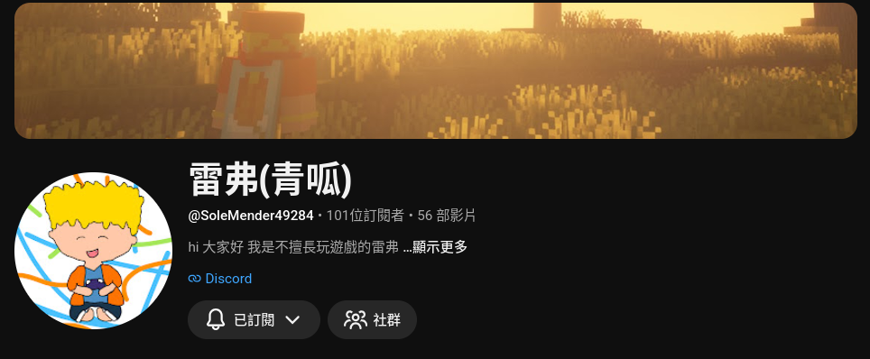
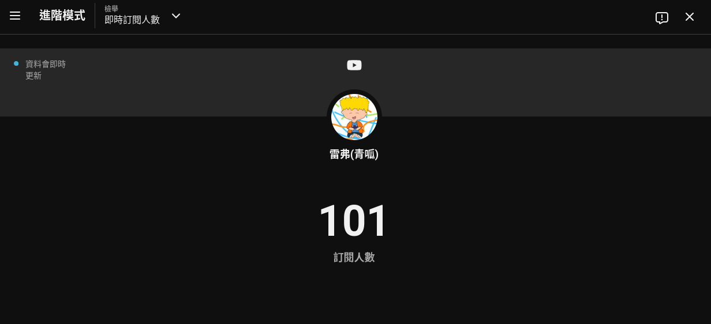
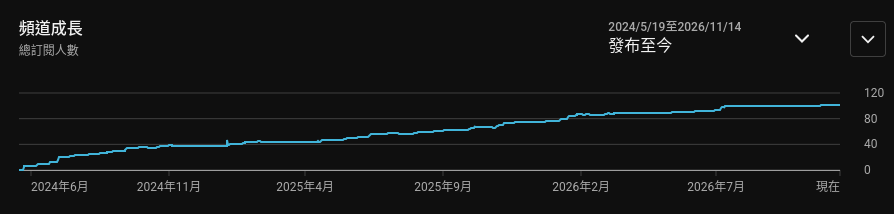

我終於是個三位數訂閱的青蛙了
## 起源
#### 記得是在國中時的某天下課的對話

同學：我Youtube有80個訂閱了ㄟ！

青呱：真假? 好少。

同學：很難，你做過就知道了。

我抱著不信邪的想法在，我考完會考後創了一個頻道。

>[!NOTE]對話內容大概的意思，太久了已經忘記實際的句子和訂閱數了。

嗚嗚嗚 真的好難 我錯了
## 取名
頻道明好難想，我要叫什麼？
雷...？格...？

最後決定叫「雷弗」，因為我當時遊戲的名字都取「格里弗雷特森 」，就決定取裡面的2個字唸起來順口的
## 聽到自己的聲音
印象中我第一次開麥克風錄音聽到自己的聲音我笑了許久，剪了幾部影片才習慣。
一開始我是拍完寫稿再錄音後來變成一邊錄影一邊講話，到現在還常常忘記講話或是講太少，導致我剪影片時時常發現片長不夠，剪出來不到3分鐘。
## 各種Minecraft系列
### 原味生存
- 狀態：2024-05-25~2024-07-13 (8集)
- 介紹：最一開始的影片系列
### 工業生存
- 狀態：2024-07-20~2024-08-10 (7集)
- 介紹：我想要蓋些機器
### minecraft生存
- 狀態：2025-01-22~2025-06-08 (4集)
- 介紹：放寒假了發現上次發片是4個月前
### 某服主的生存
- 狀態：2025-07-31~2025-09-29 (3集)
- 介紹：伺服器開了怎麼剩下我在玩
### 100集生存挑戰
- 狀態：2025-11-08~至今
- 介紹：挑戰拍100集以上 失敗開直播加班30小時 也想衝衝看訂閱 目標500訂閱

> [!TIP]我好像有一堆爛尾的系列...

## 記錄

發布至今的訂閱數(2026-11-15)

訂閱數折線圖