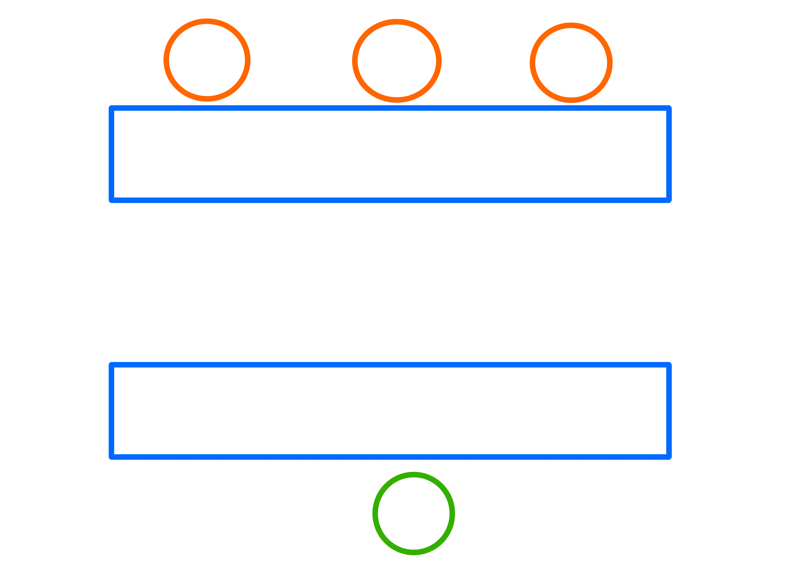

去之前先去買瓶特上紅茶，跟伺服器上壓乖乖和靠得住一樣（？

我大概提前30分鐘到，報到看身份證和簽名然後找個位置坐下等面試。

隨著時間越近越緊張，也開始有手汗。被叫名字能準備時太緊張我直接站了起來，不知道過了多久
換我了被叫出去再面試教室的門口等待。

進去前工作人員提醒先敲門再進去，出來從另一個門出，我看到上一個從原本的門出加上我太緊張也忘記要走另一個門出來

## 位置
3個教授面試輪流問問題

外面的工作人員會敲門提醒時間吧(印象中聽到2次)

藍色桌子，橘色教授，綠色我

## 面試問題

> [!TIP] 用僅存德記憶整理，意思大致相同，問題順序不確定。
教授由左到右用A,B,C表示

**B教授：** 用2到3分鐘自介？

我講了一段很炸裂的自介還卡2次了，講到我把token上傳到github時教授笑了。

**B教授：** ai的看法使用？

教導者 token那一次自己寫沒給他確認 ai重複性高的 密鑰的東西不會給ai碰 
> [!NOTE] 這一題我講的很亂，有點已讀亂回，沒聽清楚，用我聽到的關鍵字講，十分的炸

**A教授：** debian 和 ubuntu使用上的差異？

- debian 比較老穩定，ubuntu社群資源多

**A教授：** 為什麼有兩套不用一套？

- 我目前伺服器是使用Debian，日常使用arch

**C教授：** 我大概10年前也有玩Minecraft 你知道紅石嘛？

- 我會用來蓋機器收集東西

**C教授：** 有自己改過機關嘛？

- 有改過tnt複製的 (我沒講到我改完後機器整台炸了 事後才想到)

**B教授：** 你提到找影片是怎麼找的？

- minecraft的嗎？

- 看我需求製造，像是我需要石頭，我會去yt查蓋收集石頭的影片，看版本和哪個喜歡選擇

> [!NOTE]C教授還有跟我講他之前蓋雞的東西 收集羽毛和肉 簡單講他蓋的